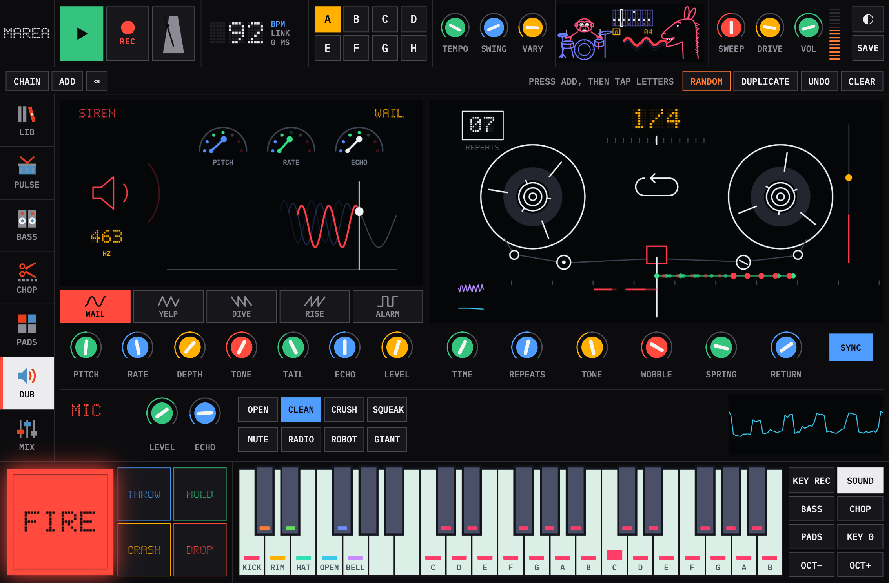
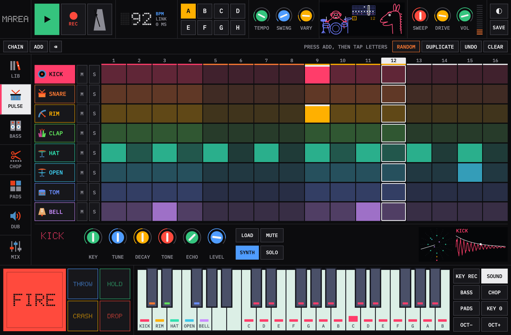
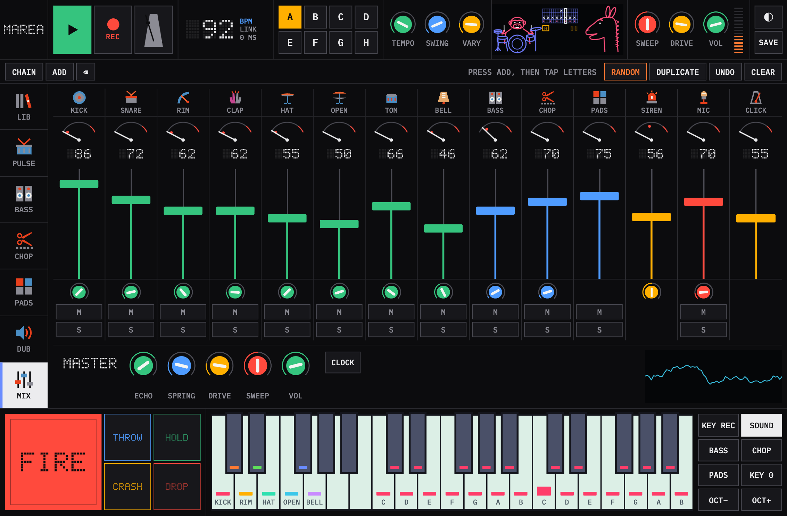
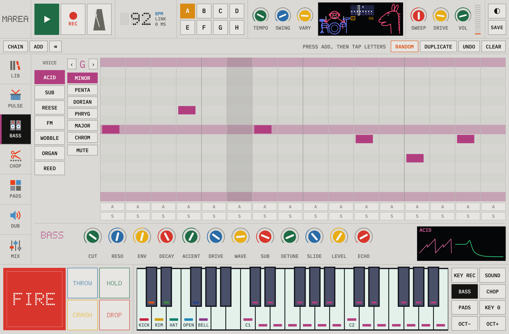
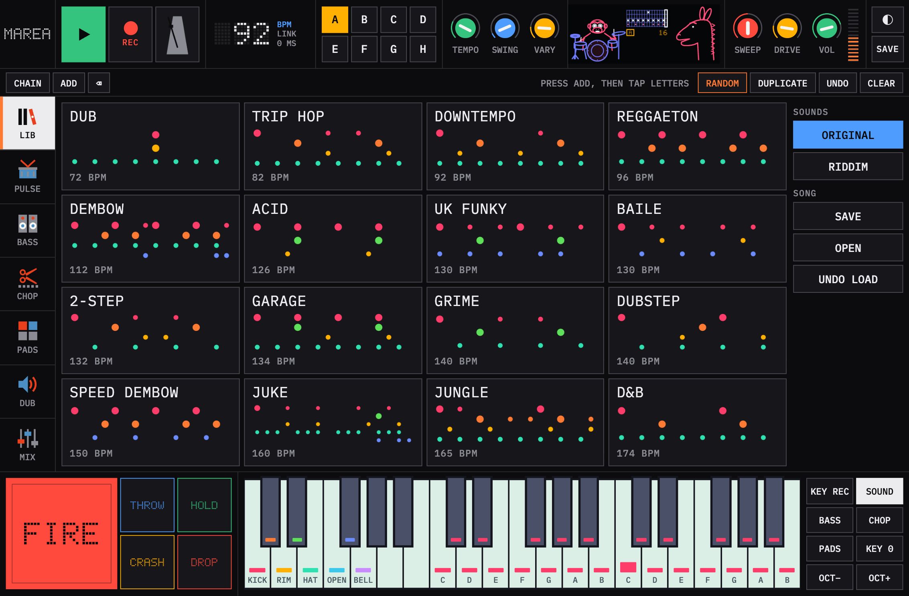
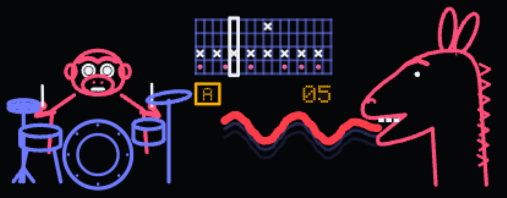

# Marea

A hands-on rhythm, bass and dub instrument for Ableton Live, the Mac and the iPad. Black screens, thin line drawings, dot-matrix numbers and big square buttons, so you can play it instead of programming it.

If Marea is useful to you, you can buy me a coffee: [paypal.me/paymepleeez](https://paypal.me/paymepleeez)



| | |
|---|---|
|  |  |
|  |  |



- **LIB:** 16 starting grooves ordered by tempo, from dub, trip hop and downtempo up through reggaeton, dembow, UK funky, grime and dubstep to jungle and D&B. Song save and open.
- **PULSE:** 8 synthesized drum voices on coloured 16-step lanes, 8 patterns, a chain, DUPLICATE, RANDOM and a VARY amount that changes a few hits each pass.
- **BASS:** 7 voices (acid, sub, reese, FM, wobble, organ, reed) on a scale-locked grid with accents, slides and long notes.
- **CHOP:** load or record a sound; it finds the tempo, cuts it on the beat and lays the slices across the patterns.
- **PADS:** 24 sample pads with their own steps, and a browser to drag sounds from your library onto them.
- **DUB:** a siren and a tape echo you can watch, plus a live mic channel with effects for talking over the mix.
- **MIX:** levels, meter dials, echo sends, mute and solo for every part, a click, and MIDI clock out for gear like a Volca.
- **Deck:** always on screen, with FIRE, THROW, HOLD, CRASH, DROP and a 3-octave keyboard that plays drums, bass, chops, pads or retunes the selected sound.

The header screen plays along: a gorilla drums with the kit, the pattern runs in the middle, and when the siren fires the donkey sticks its tongue out in the siren's own wave shape. When VARY changes a step, they raise their eyebrows.

All sounds are synthesized in code or loaded from your own files; no samples ship with it. The type is IBM Plex Mono (SIL Open Font License), bundled so everything works offline.

It comes in three forms that share one engine and panel: an Audio Unit for Live (`Marea.component`), a Mac app (`Marea.app`), and an iPad app that runs entirely on the iPad. An iPad can also remote-control the Mac versions through Safari.

## Use it in Live

1. In Live's browser, open **Plug-Ins › Marea Instruments › Marea** and double-click it, or drag it onto a MIDI track. "Use Audio Units v2" must be on in Settings › Plug-Ins.
2. Press Live's Play. The drums follow Live's tempo and position, and the play button turns amber to show it's locked. Press Marea's own play button to run the drums while Live is stopped.
3. If you close the window, click the small wrench icon on the device in Live to reopen it.

## The iPad app

Tap the Marea icon. No Mac, Live or Wi-Fi is needed: the engine runs on the iPad and sound comes from the iPad. MIC uses the iPad's own microphone. A USB or Bluetooth MIDI keyboard connected to the iPad plays it. Sound keeps playing when you switch apps.

To add audio files, press LOAD, then "From this device" to pick from the Files app, or put them in the Marea folder in Files, which then appears in LOAD.

To install or reinstall, put your iPad's ID and your Apple team ID in a `local.env` file next to this README (it isn't shared):

```
MAREA_DEVICE=<iPad UDID from: xcrun devicectl list devices>
MAREA_TEAM=<your Apple developer team ID>
```

For the App Store build, `./release-ipad.sh` archives Marea, raises the build number in `ios/VERSION` and uploads it to App Store Connect. It needs a paid developer account and `MAREA_BUNDLE` in `local.env`. Listing text and screenshots are in `docs/appstore/`.

Then connect the iPad and run:

```bash
./install-ipad.sh
```

With a free Apple ID the app stops opening 7 days after install. Run the same command to renew it; your patterns and sounds stay. A paid developer account extends this to a year. There's no sync to Live yet, so tempo is set on the iPad.

## Remote-controlling the Mac from the iPad

Open Marea on the Mac, press **iPAD** in the header, and scan the QR code with the iPad on the same Wi-Fi. In Safari choose Share, then Add to Home Screen, for a full-screen icon. The iPad shows the same panel and pages as the Mac. Everything stays in sync with the Mac in both directions. The Mac must be running Marea, because the sound comes from the Mac and not the iPad.

## Controls worth knowing

| Do this | To get this |
|---|---|
| Drag a knob up or down (Shift for fine moves) | Change the value; the readout shows the name and value |
| Double-click or double-tap a knob | Go back to its default |
| Tap a step | Turn it on or off |
| Hold a step | Accent it, shown brighter |
| Press GEN | New beats on PULSE, a new melody on BASS, a new slice order on CHOP |
| Tap a pattern letter | Switch at the next bar; it blinks while waiting |
| Press KEY REC, then play the keyboard | Stamp notes into the steps: the nearest step while running, the next step when stopped |
| Keyboard, left 8 keys | Always the drum lanes, matched by colour |
| Keyboard, from the second C up | Whatever BASS, CHOP or PADS is lit |
| A S D F G H J K on the Mac, Space | Drum lanes, play and stop |
| Hold THROW / HOLD | Send the mix into the echo / keep the echo repeating with no new input |
| Hold DROP | Cut everything but the hats |
| Drag on the isometric grid (DUB) | Move echo time and repeats together; time changes bend the pitch |

## Songs, chains, variation and recording

- **Chain:** press ADD, tap pattern letters in the order you want, and press CHAIN to play them one bar each. Tap a letter in the strip to remove it.
- **VARY:** the chance that each step plays differently on each pass: 5% means about 95% stays as you wrote it. Your pattern is never changed. A dot marks a step that was varied.
- **REC (top row):** records everything Marea plays to a WAV in the Takes folder (`~/Music/Marea/Takes` on Mac, Marea in the Files app on iPad).
- **SAVE and OPEN (LIB page):** songs live in the Songs folder beside Takes. Inside Live, your set also stores Marea's state.
- **Library:** tapping a style replaces patterns A to D, clears E to H, sets knobs and sets up a chain. UNDO LOAD brings back what you had.
- **RIDDIM (LIB page):** loads sounds from your own Riddim folder onto the lanes and pads. They're read from disk and never bundled into Marea.
- **LOAD on PULSE:** puts any sample on the selected lane; SYNTH goes back to the built-in voice.
- **FX on PADS and CHOP:** RADIO, CRUSH, ROBOT, SQUEAK or GIANT, applied to what the microphone records.

## Chopping and recording

Drop a file on the CHOP page, or press LOAD. A BPM in the filename is used directly; otherwise the tempo is detected from the audio. Detection can land on half or double time, so ÷2 and ×2 are there to correct it. Slices are retriggered at the current tempo, so the loop follows any BPM without changing pitch. SPEED changes to turntable behaviour, where pitch follows tempo. Grid buttons re-cut on the beat, and HITS cuts on transients instead.

Pattern A holds the first bar, B the second, and so on, repeating if the loop is shorter.

● MIC records from the Mac's input and ● OUT records Marea's own output, for up to 30 seconds. The result lands on the selected pad or on CHOP and is saved in `~/Library/Application Support/Marea/Samples`. The iPad's REC buttons record on the Mac, because Safari only gives pages the microphone over HTTPS. To use a recording made on the iPad, load it through LOAD and "From this device".

## Playing it from MIDI clips in Live

What notes play follows the page: PULSE uses the map below, BASS plays the bass, and CHOP plays slices from C1 up. MIDI channel 2 always plays the bass and channel 3 always plays slices.

| Note in Live | Plays |
|---|---|
| C1 D1 C#1 D#1 F#1 A#1 F1 G#2 | Kick, snare, rim, clap, hat, open hat, tom, bell |
| C2 to F2 | Sample pads 1 to 6 |
| C3 C#3 D3 D#3 E3 | Hold siren fire, throw, hold, crash, drop |
| C5 to G5 | Select patterns A to H |

To automate a knob, click **Configure** on the device in Live and then move the knob on the panel.

## Latency

The panel server answers in well under a millisecond, so lag comes from the route around it. The iPad shows its round trip in the BPM box, usually from Wi-Fi. In Live, lower the buffer size under Settings › Audio and prefer the Mac's speakers or a wired interface, because audio sent over HDMI to a monitor adds delay.

## Build

Xcode's command line tools are the only requirement.

```bash
./build.sh install
```

This builds both products and installs them to `~/Library/Audio/Plug-Ins/Components` and `~/Applications`. Quit Live first if it's using the plugin, because Live reads the plugin at launch.

Tests:

```bash
auval -v aumu Mr01 Mrea
./build/render_test /path/to/empty/folder
python3 tools/analyze.py /path/to/empty/folder
```

`render_test --serve web` runs the real engine and server without sound, which is handy for working on the panel in a browser.

## Adding a module

1. Write `src/modules/yourmodule.h`, a class derived from `Module` (`src/module.h`). Register parameters with a new block of IDs and never change an ID once it's released, because Live stores them in saved automation.
2. Add it to `Engine` in `src/engine.h` and to the `modules` list in the constructor in `src/engine.cpp`.
3. In `web/modules.js`, write a function that returns a page using `Knob`, `Toggle` and `Momentary`, keyed by your parameter names, and add it to `M.pages` in `buildPanel()`, with an icon and colour in `PAGE_ICONS` and `PAGE_COLORS`. Parameters reach the panel, the iPad and Live's automation without any other wiring.

## How it fits together

| File | Job |
|---|---|
| `src/engine.*` | Sequencer, modules, master bus. No audio-API or network code |
| `src/modules/*` | The sounds |
| `src/analysis.cpp` | Tempo detection and slicing |
| `src/core.mm` | Saved state, sample loading and recording |
| `src/server.mm` | HTTP and WebSocket server that feeds the panel and the iPad (first free port from 8060) |
| `src/au.mm` | Audio Unit v2 wrapper and plugin window |
| `src/app.mm` | Mac app |
| `ios/main.mm` | iPad app: audio session, window and panel |
| `src/midi_input.mm` | Hardware MIDI for both apps |
| `web/` | The panel; the same page runs in all three places |

Access is protected by a random code in `~/Library/Application Support/Marea/token`, which is part of the QR link. Delete that file to change the code. Anyone on your network with the link can control Marea and browse audio files in `~/Desktop/music`, `~/Music` and `~/Downloads`. Traffic is unencrypted, so use it on networks you trust.

All sounds are synthesized by this code, and the panel is an original design. No samples, branding or layouts were taken from other makers.

## Pads, keys and latency notes

- PADS has 24 pads with a sequence per pattern, stored with the pattern, so DUPLICATE and CHAIN carry them.
- SOUND on the keyboard plays the selected lane, pad or slice chromatically and leaves it in that key. KEY 0 resets it.
- The display in the header's BPM cell shows `OUT n MS`: what the current audio output adds. Bluetooth headphones add most of the delay you hear and nothing in an app can remove it.
- On iPad, `ios/main.mm` plays keys and pads straight from the native touch (`InstantTouch`); `Core::instantHit` drops the page's copy of the same press.

## Support

Marea is free. If you enjoy it and want to help keep it going, donations are welcome at [paypal.me/paymepleeez](https://paypal.me/paymepleeez).
